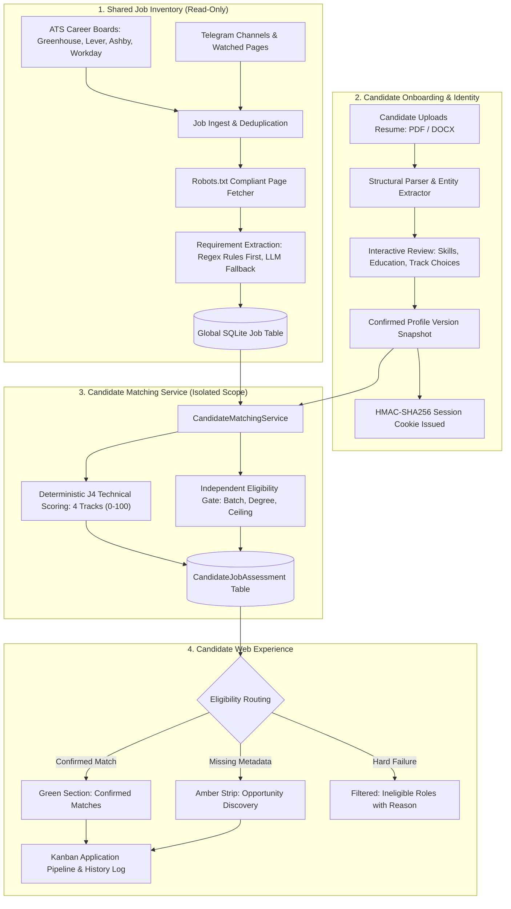
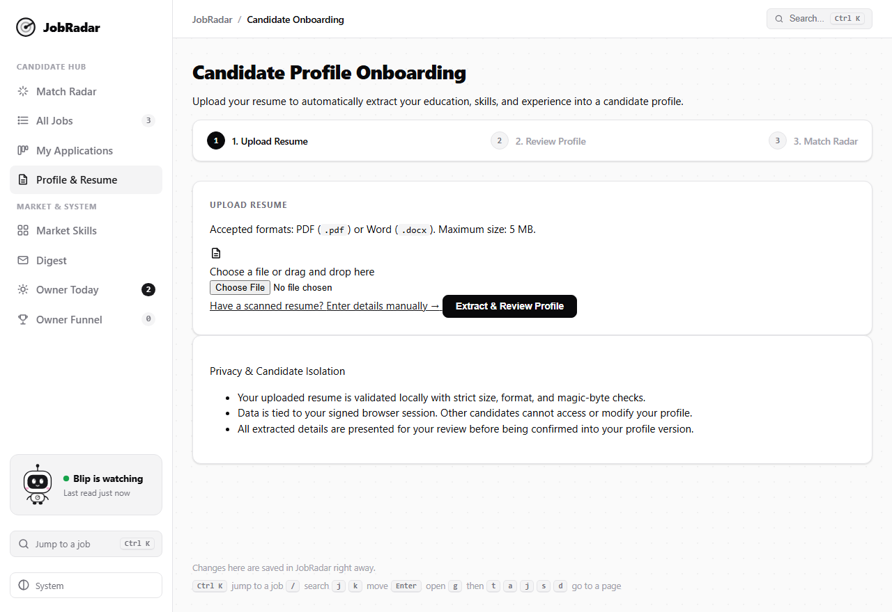
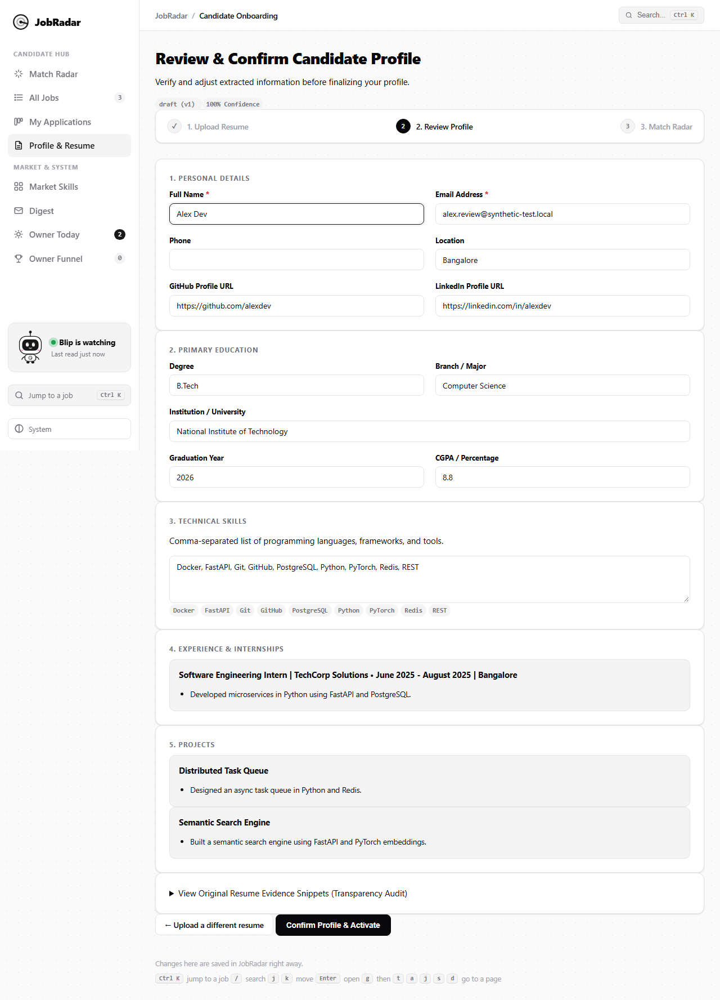
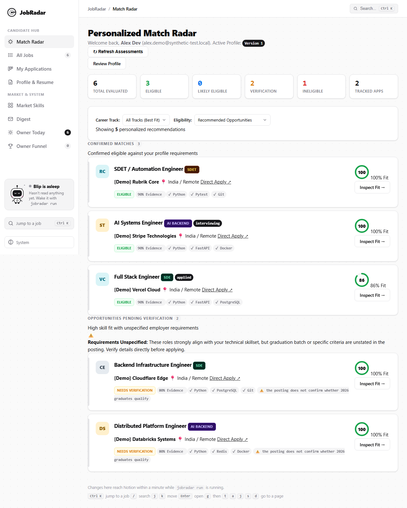
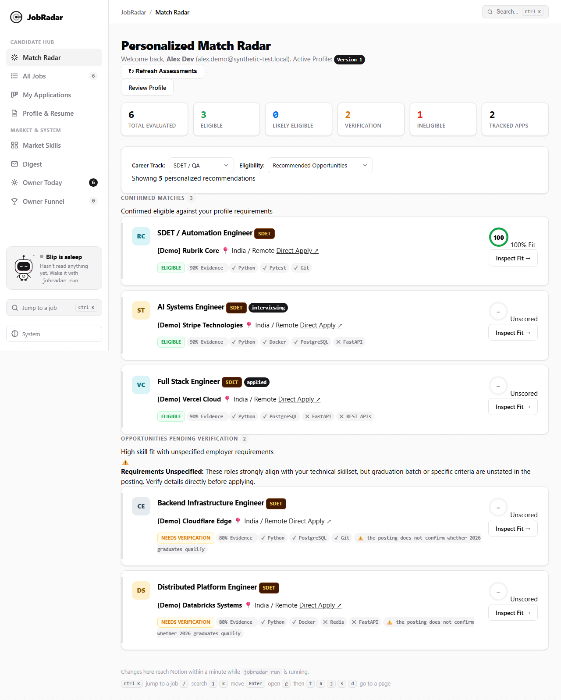
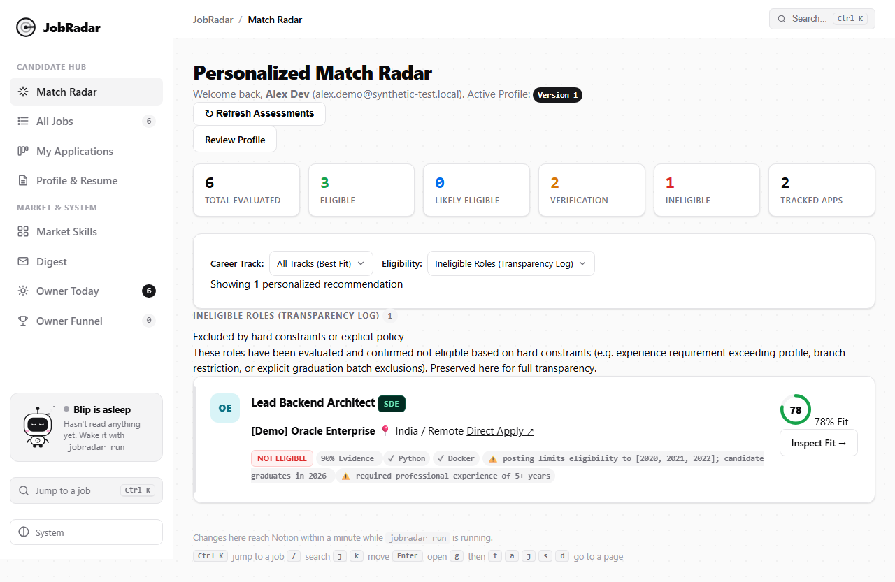
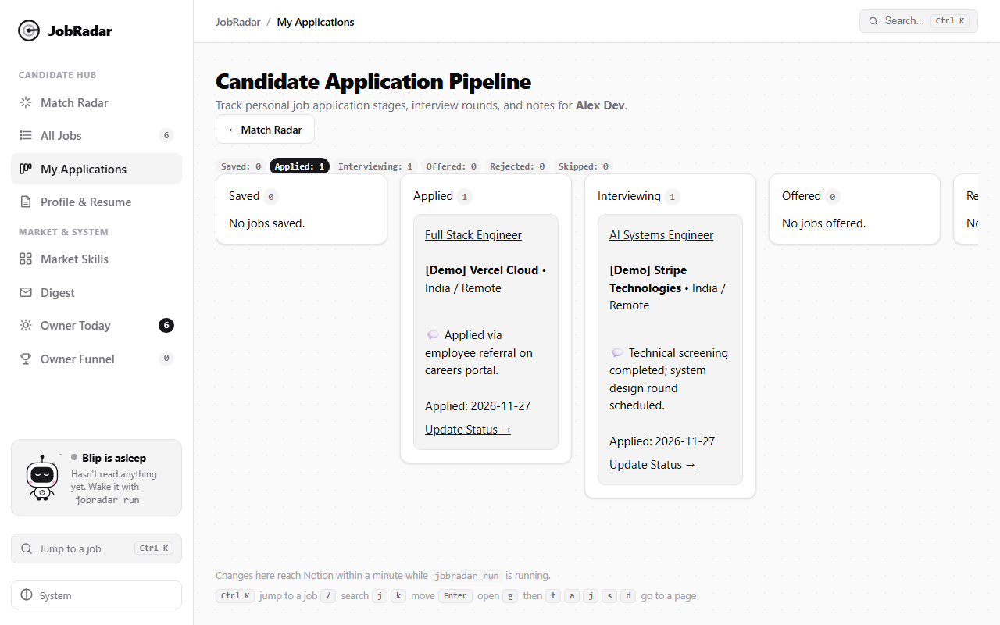

# JobRadar: AI-Assisted, Multi-Candidate Career Intelligence Platform

[](LICENSE)
[](pyproject.toml)
[](pyproject.toml)
[](pyproject.toml)
[](submission/07_testing_and_validation_evidence.md)

JobRadar is a local-first career intelligence platform designed to help technical job seekers discover hiring opportunities, evaluate technical alignment across specialized career tracks, independently verify eligibility constraints, and track applications through an accessible candidate dashboard.

Originally created as an open-source personal job-search script by **Sameer** ([@ThePlator](https://github.com/ThePlator)), this repository represents an extensive architectural re-engineering into a multi-candidate, four-track technical matching platform with independent eligibility gating, resume ingestion, and real-time opportunity discovery.

---

## Evaluation Context

- **Evaluation Target:** Spektra Systems: AI-Native Software Engineer - Trainee
- **Candidate Repository:** [https://github.com/Bharadwaj710/JobRadar.git](https://github.com/Bharadwaj710/JobRadar.git)
- **Active Branch:** `feat/j4-career-tracks` (Base HEAD: `fdd739b`)
- **Primary Deliverables:** Multi-candidate tenant architecture, four-track J4 matching engine, opportunity discovery strip, Vercel-inspired responsive UI, and verified demo environment.
- **Submission Dossier:** Comprehensive engineering reports and validation evidence are indexed in [submission/README.md](submission/README.md).

---

## 1. Problem Statement

Early-career software engineering candidates in India face several structural challenges during their job search:
- **Scattered and Ephemeral Postings:** Postings appear unpredictably across company applicant tracking systems (Greenhouse, Lever, Ashby, Workday, SmartRecruiters), Telegram groups, and hiring drive announcements.
- **Incomplete and Ambiguous Metadata:** Job postings routinely omit explicit graduation year requirements or describe experience ambiguously, causing naive filtering algorithms to falsely hide high-relevance positions.
- **Conflated Scoring:** Monolithic job board algorithms combine skill competence and rigid eligibility gates into a single opaque percentage, confusing suitability with hard gating.
- **Lack of Transparent Reasons:** Candidates rarely receive actionable feedback explaining which skills were matched, which are missing, and why an application may be filtered out.
- **Data Privacy Risks:** Commercial job portals centralize candidate resumes and personal details in shared cloud databases, exposing applicants to spam and untracked third-party access.

JobRadar addresses these problems by providing a local-first platform that decouples technical skill alignment from non-negotiable eligibility criteria, preserves high-potential unverified opportunities, and keeps all candidate data under personal control.

---

## 2. Open-Source Origin & Contribution Transparency

This project builds upon an open-source foundation. In accordance with ethical engineering and open-source practices, the distinction between the original upstream project and my extensions is detailed below:

- **Original Project:** [JobRadar](https://github.com/ThePlator/JobRadar)
- **Original Author:** Sameer ([@ThePlator](https://github.com/ThePlator)), Electrical Engineering fresher in India
- **Original Base Commit:** `fdd739b`
- **Original License:** MIT License (preserved in [LICENSE](LICENSE))
- **Original Upstream Documentation Archive:** Preserved in [docs/ORIGINAL_README.md](docs/ORIGINAL_README.md)

### What the Original Foundation Provided:
- Python job ingestion pipeline and source adapters (Telegram channel readers, career board crawlers, email forwarders).
- URL normalization, link expansion, and posting deduplication.
- Initial HTML/text extraction heuristics and fallback LLM extraction infrastructure.
- SQLite persistence layer and background task queue architecture.
- Single-user LaTeX resume tailoring template and basic CLI tooling.

### What I Built and Extended:
- **Multi-Candidate Architecture:** Replaced the hardcoded single-profile configuration with an isolated multi-candidate data model, HMAC-SHA256 session token management, and Insecure Direct Object Reference (IDOR) prevention.
- **Resume Onboarding & Interactive Review:** Built automated PDF/DOCX resume text extraction, entity parsing, and an interactive web review interface allowing candidates to edit parsed skills, education, and track preferences before confirming immutable profile versions.
- **Four-Track J4 Matching Engine:** Designed and implemented a deterministic technical scoring engine evaluating jobs independently across AI Backend, Full Stack, SDE / Systems, and SDET / QA tracks.
- **Separate Eligibility Evaluation:** Architected an independent eligibility gating engine that separates technical competence from hard requirements (graduation year, degree branch, experience ceiling), producing four distinct semantic states (`ELIGIBLE`, `LIKELY_ELIGIBLE`, `NEEDS_VERIFICATION`, `NOT_ELIGIBLE`).
- **Real-Time Opportunity Discovery:** Implemented an amber discovery strip on the candidate dashboard to surface postings with missing graduation metadata rather than falsely discarding them.
- **Candidate Application Tracking:** Built an interactive Kanban application pipeline (`Saved` -> `Applied` -> `Interviewing` -> `Offered` -> `Rejected`) with complete candidate isolation and audit history logging.
- **Vercel-Inspired UI System:** Redesigned the frontend using Geist typography, custom CSS properties, an accessible dark/light theme toggle, and responsive mobile navigation.
- **Isolated Deterministic Demo Environment:** Created a safe, reproducible demo seeder (`scripts/prepare_demo_data.py`) operating against an isolated database with synthetic test personas and zero mutation of production data.

---

## 3. Four-Track J4 Technical Matching Engine

JobRadar recognizes that modern software engineering candidates specialize in distinct functional disciplines. Rather than calculating a single generic match score, the engine evaluates each job posting independently across four technical tracks:

1. **AI Backend:** Focuses on Python, FastAPI, PyTorch, LangChain, LLM APIs, SQL, Docker, vector search concepts, and asynchronous microservices.
2. **Full Stack:** Focuses on React, TypeScript, Node.js, Next.js, HTML5/CSS3, RESTful APIs, and modern frontend/backend integration.
3. **SDE / Systems:** Focuses on C++, Go, Java, Linux internals, operating systems, distributed architectures, networking, and algorithms.
4. **SDET / QA Automation:** Focuses on Pytest, Selenium, Playwright, CI/CD automation, load testing, mock services, and end-to-end test design.

A single job posting can be assessed across multiple tracks. For example, a backend platform vacancy might achieve an 88% match in AI Backend but only a 45% match in Full Stack.

### What the Technical Match Score Means
The technical match score (0 to 100) reflects technical suitability based on verified candidate evidence and implemented weighted criteria. It is **not** a guarantee of an interview or a probability of being hired.

The score is calculated deterministically using eight weighted components defined in [src/jobradar/pipeline/technical_match.py](src/jobradar/pipeline/technical_match.py):

| Component Name | Weight | Evaluation Method |
|---|---|---|
| **Role Alignment** | 25% | Matches job titles and core functional descriptions against track taxonomies. |
| **Required Skills** | 25% | Checks mandatory technical skills against approved candidate evidence. |
| **Project & Internship Relevance** | 15% | Evaluates whether candidate projects demonstrated the technologies required by the role. |
| **Education & Graduation Fit** | 10% | Assesses academic degree level and graduation timeline alignment. |
| **Experience & Seniority Fit** | 10% | Compares candidate experience duration against requested seniority level. |
| **Preferred Skills** | 5% | Grants bonus weighting for optional or nice-to-have competencies. |
| **Location & Work Mode** | 5% | Checks alignment between posting location (remote/hybrid/onsite) and candidate preferences. |
| **Compensation** | 5% | Evaluates salary alignment when salary data is published in the posting. |

### Evidence-Based Matching
The matching engine operates strictly on verified evidence extracted from candidate projects, experience descriptions, and confirmed skills. If a skill requirement is not evidenced in the candidate profile, it remains marked as missing or unknown. The engine never invents or hallucinates candidate qualifications.

---

## 4. Independent Eligibility Evaluation

A central architectural principle of JobRadar is the strict separation between **technical skill alignment** and **hard eligibility constraints**.

A candidate may possess a 95% technical skill match for a role but remain ineligible because the employer enforces a specific graduation batch or requires several years of industry experience. Conversely, a candidate who meets all eligibility criteria may lack the specific technical stack required for the position.

### The Four Eligibility States:

- **`ELIGIBLE`:** All hard requirements (graduation year, degree branch, experience ceiling) are explicitly met based on verified posting criteria.
- **`LIKELY_ELIGIBLE`:** Hard criteria are strongly implied by posting context with zero contradictory constraints found.
- **`NEEDS_VERIFICATION`:** Essential eligibility criteria are omitted from the job posting (for example, the ATS posting does not specify a graduation year).
- **`NOT_ELIGIBLE`:** The posting explicitly conflicts with candidate constraints (for example, requires 5+ years of experience or a 2021 graduation batch).

### Opportunity Discovery for Missing Information
Real-world applicant tracking systems frequently publish early-career roles without mentioning graduation years. Under traditional filtering, such jobs are discarded as non-matches.

JobRadar preserves these opportunities by classifying them as `NEEDS_VERIFICATION` and surfacing them on the candidate dashboard in an amber **Opportunity Discovery** strip. Candidates are presented with transparent explanations indicating exactly which criteria require manual verification before applying.

---

## 5. System Architecture & End-to-End Workflow



### End-to-End Workflow:
1. **Global Ingestion:** Public job postings are ingested, deduplicated, and extracted into a shared, immutable inventory table.
2. **Candidate Onboarding:** A candidate uploads a resume (PDF/DOCX), reviews extracted entities, customizes preferred career tracks, and confirms an immutable profile version.
3. **Multi-Track Evaluation:** The `CandidateMatchingService` evaluates all active jobs against the candidate profile, computing four track scores and an independent eligibility verdict.
4. **Dashboard Presentation:** The candidate dashboard categorizes opportunities into Confirmed Matches, Opportunity Discovery leads, and Ineligible roles with detailed evidence breakdowns.
5. **Application Management:** The candidate tracks application progression on an isolated Kanban board with state transition logging.

---

## 6. Transparent AI Usage: Runtime AI vs. Deterministic Logic

JobRadar maintains a clear boundary between artificial intelligence and deterministic software engineering:

```
+---------------------------------------------------------------------------------------+
|                                    JOBRADAR SYSTEM                                    |
|                                                                                       |
|  [ Runtime AI ]                                [ Deterministic Intelligence ]         |
|  - LiteLLM integration (Gemini / Groq)         - Four-track J4 technical match (0-100)|
|  - Fallback job description entity parser      - Eligibility rules (batch, degree)    |
|  - Strict Pydantic structured output schemas   - Deterministic resume entity parser   |
|  - Zero tool execution / zero agentic loops    - HMAC-SHA256 session token management |
|  - Configurable daily INR budget cap           - SQLite full-text search (FTS5)       |
|                                                - Candidate isolation & IDOR prevention|
+---------------------------------------------------------------------------------------+
                                           ^
                                           | Built With
+---------------------------------------------------------------------------------------+
|  [ AI-Assisted Development (Engineering Time) ]                                       |
|  - Claude Code and Antigravity used as developer software engineering agents          |
|  - Automated test generation (994 unit tests, 6 Playwright E2E browser tests)         |
|  - Architectural refactoring, Mypy strict type hardening, and documentation           |
+---------------------------------------------------------------------------------------+
```

### 1. Runtime AI (Application Features)
- **Targeted LLM Job Description Fallback:** An LLM is called strictly when deterministic regex and heuristic rules fail to parse complex, unstructured job descriptions from scraped job postings (`src/jobradar/pipeline/extract.py`).
- **Provider Support:** Uses LiteLLM to interface with Google Gemini (`gemini-flash-lite-latest`) or Groq.
- **Structured Schema Enforcement:** Prompts treat raw text as data, disallow tools or external network calls, and validate outputs against strict Pydantic schemas.
- **Budget Guardrails:** Adheres to a configurable daily budget cap (`llm.daily_budget_inr`) with call counters.

### 2. Deterministic Intelligence (Rules & Math)
- **Resume Ingestion & Entity Parsing:** Resume text extraction from PDF/DOCX and entity parsing (contact details, education, technical skills, projects) are performed entirely by deterministic Python rules, regex, and taxonomy matching (`src/jobradar/resume/extract.py`, `src/jobradar/resume/parser.py`) without calling an LLM.
- **Technical Match Scores:** The 0-100 track scores are computed entirely by deterministic Python code using weighted taxonomy intersections. No LLM generates or adjusts these scores (`src/jobradar/pipeline/technical_match.py`).
- **Eligibility Gates:** Eligibility verdicts (`ELIGIBLE`, `NOT_ELIGIBLE`, etc.) are decided by deterministic boolean logic checking batch years, degree branches, and experience limits (`src/jobradar/pipeline/eligibility.py`).
- **What is NOT Implemented:** JobRadar does not use vector embeddings, vector databases (such as Pinecone, Chroma, or Qdrant), retrieval-augmented generation (RAG), or autonomous application-submitting bots. Candidates manually submit every application.

### 3. AI-Assisted Engineering (Development Methodology)
- Software engineering agents (Claude Code and Antigravity) were utilized as developer tools under human direction.
- Agents assisted in codebase exploration, architectural refactoring, writing comprehensive Pytest and Playwright suites, enforcing strict static typing (`mypy strict`), and structuring documentation. All outputs were subject to human review and quality gates.

---

## 7. Technology Stack

### Core Platform (Delivered Application):
- **Language & Runtime:** Python 3.11.18+ (asynchronous architecture via `asyncio`)
- **Web Framework:** FastAPI / Starlette / Uvicorn with Jinja2 server-side template rendering
- **Database Layer:** SQLite 3.45+ with FTS5 full-text search, SQLModel / SQLAlchemy
- **Document Processing:** `pypdf`, `python-docx`, `trafilatura`, `beautifulsoup4`
- **LLM Abstraction:** LiteLLM (supporting Google Gemini and Groq with Pydantic validation)
- **Frontend Architecture:** Modern vanilla JavaScript, semantic HTML5, CSS custom properties, Geist typography
- **Quality & Testing:** Pytest 9.2+, Playwright Chromium, Ruff linter and formatter, Mypy strict type checker
- **Environment Management:** `uv` package manager

### Inherited & Optional Integrations:
- `telethon`: Optional Telegram channel listener (requires user Telegram API credentials).
- `aiosmtplib` & `imap-tools`: Optional SMTP email alert dispatch and IMAP reply reader.
- `notion-client`: Optional Notion mirror (disabled by default in candidate configuration).

---

## 8. Visual Demonstration & Interface Walkthrough

Below are genuine interface captures from the local JobRadar application running against the synthetic demo dataset:

### 1. Resume Onboarding & Entity Extraction
Candidates upload resumes in PDF or DOCX format. The parser extracts technical skills, education timelines, and work history.



### 2. Interactive Profile Review & Confirmation
Candidates review, edit, and confirm parsed details before generating an immutable profile version snapshot.



### 3. Candidate Dashboard & Opportunity Discovery
High-level overview displaying Confirmed Matches alongside the amber Opportunity Discovery strip (`NEEDS_VERIFICATION`) for roles with omitted batch years.



### 4. Track-Specific Best Match Filtering (SDET Track)
Filtering by a specific track dynamically re-ranks opportunities according to that track's unique technical requirements.



### 5. Ineligible Roles Transparency Log
When a role is classified as `NOT_ELIGIBLE`, the interface provides an explicit explanation of the hard constraint violation.



### 6. Job Fit Detail & Skill Gap Breakdown
Deep-dive view showing covered technical skills (green), alternative competencies (blue), and missing requirements.


### 7. Applications Kanban Board
Candidate-isolated application pipeline tracking application stages with audit history.



*All screenshots reflect synthetic demonstration records with zero personal identifying information.*

---

## 9. Local Setup & Execution Guide

### Prerequisites
- Python 3.11 or higher
- [uv](https://github.com/astral-sh/uv) package manager (recommended) or standard `pip`
- Git

### Step 1: Clone the Repository
```powershell
git clone https://github.com/Bharadwaj710/JobRadar.git
Set-Location JobRadar
```

### Step 2: Initialize Virtual Environment & Install Dependencies
```powershell
uv venv
.venv\Scripts\activate
uv sync --extra web
```

### Optional: Install Browser Test Dependencies
If running Playwright browser automation tests, install the optional `browser` dependencies and Chromium binaries separately:
```powershell
uv sync --extra web --extra browser
uv run playwright install chromium
```

### Step 3: Configure Environment Variables
Copy the example configuration:
```powershell
Copy-Item .env.example .env
```
*(Optional) If using LLM fallback extraction, configure your Gemini or Groq API key in `.env`:*
```bash
GEMINI_API_KEY=your_api_key_here
```

### Step 4: Run the Isolated Demo Environment (Recommended)
JobRadar includes a deterministic, offline demo environment that provisions synthetic candidate **Alex Dev**, 6 multi-track demo jobs, and 24 J4 assessments:

```powershell
# 1. Deterministically reset and seed the demo database
uv run python scripts/prepare_demo_data.py --reset

# 2. Point to the demo database
$env:JOBRADAR_DB_PATH = "data/demo/jobradar_demo.db"

# 3. Launch the web dashboard
uv run jobradar web
```

Open your browser and navigate to:
```
http://127.0.0.1:8080/candidate/dashboard
```

Verify demo integrity at any time:
```powershell
uv run python scripts/prepare_demo_data.py --verify
```

### Optional: Ingestion Pipeline Workflow
To run the background ATS board crawlers and task workers on a local database (separate from demo mode):
```powershell
# Run the pipeline worker and dashboard concurrently
uv run jobradar run
```
*Note: Full board crawling requires active internet connectivity. Telegram and email sources require additional credentials configured in `config/config.yaml`.*

### Troubleshooting Common Issues
- **Port 8080 Already in Use:** The server automatically scans and binds the next available port in the 8080-8089 range. To configure a specific port, update `web.port` in `config/config.yaml`.
- **Database Path Confusion:** Ensure `$env:JOBRADAR_DB_PATH` is set when evaluating the demo database; otherwise, the app defaults to `data/jobradar.db`.
- **Missing LaTeX Compiler:** If compiling raw LaTeX resumes on Windows, install MiKTeX or rely on the built-in HTML/text previews.

---

## 10. Automated Testing & Quality Gates

The codebase is protected by automated quality gates:

| Quality Dimension | Tool / Command | Evidence & Results |
|---|---|---|
| **Full Pytest Suite** | `uv run pytest` | **994 passed**, 2 skipped (Windows LaTeX compiler missing), 0 failed across 140+ test modules in 128.5s. |
| **Browser E2E Suite** | `uv run pytest tests/test_browser_candidate_flows.py` | **6 passed**, 0 failed covering onboarding, review, filtering, and tracking via Playwright Chromium. |
| **Dedicated Phase 3 E2E** | `uv run pytest tests/test_phase3_final_e2e_validation.py` | **8 passed**, 0 failed covering candidate isolation and opportunity discovery. |
| **Code Formatting** | `uv run ruff format --check` | **182 files fully formatted** (0.42s). |
| **Linter Checks** | `uv run ruff check` | **0 errors, 0 warnings** across 182 files (0.38s). |
| **Static Type Checking** | `uv run mypy src` | **Success: 0 issues in 102 source files** (strict mode, 22.18s). |
| **Production DB Invariance** | SHA-256 verification | Production database (`data/jobradar.db`) remained 100% untouched throughout all testing (`5de19c...`). |

*Note: Test counts reflect the documented verification execution recorded in [submission/07_testing_and_validation_evidence.md](submission/07_testing_and_validation_evidence.md). The dedicated Phase 3 suite (8 tests) and Playwright browser suite (6 tests) are specialized integration suites and are not double-counted with the main unit test suite.*

---

## 11. Known Technical Limitations

In the interest of engineering transparency, the following intentional boundaries are documented:

1. **Local LaTeX Compiler Dependency:** Generating compiled PDF resumes requires a local LaTeX installation (`pdflatex` or `xelatex`). When absent, the application gracefully provides structured HTML and text previews.
2. **Deferred TypeSafe Jev Integration:** The provider interface for TypeSafe Jev calibrated confidence scoring is implemented, but live integration is deferred until an API key is configured.
3. **Profile Confirmation Prerequisite:** Automated Match Radar recommendations require a candidate profile in `confirmed` status. Draft profiles are not evaluated to prevent incomplete extractions from generating false recommendations.
4. **Notion Mirroring Disabled:** Notion synchronization is disabled by default (`notion.enabled: false`) to favor the local FastAPI dashboard and avoid external SaaS rate limits.
5. **Decoupled Legacy Schema Fields:** The database retains legacy single-user columns (`job.score`, `job.status`) for backward compatibility with upstream CLI tools, but all candidate workflows operate through decoupled candidate tables.

---

## 12. Documentation Index & Provenance Links

Complete architectural specifications and submission reports:

| Document | Description |
|---|---|
| [submission/README.md](submission/README.md) | Spektra Systems submission dossier index and executive summary. |
| [submission/01_project_overview.md](submission/01_project_overview.md) | Detailed project provenance, problem statement, and scope comparison. |
| [submission/02_system_architecture.md](submission/02_system_architecture.md) | Multi-candidate isolation, J4 career track architecture, and data schemas. |
| [submission/03_end_to_end_pipeline.md](submission/03_end_to_end_pipeline.md) | Lifecycle from ATS discovery to ingestion, extraction, and tracking. |
| [submission/04_ai_agent_engineering_methodology.md](submission/04_ai_agent_engineering_methodology.md) | Agentic software engineering workflows and quality gates. |
| [submission/05_selected_agent_conversations.md](submission/05_selected_agent_conversations.md) | 7 authentic agent-developer problem solving case studies. |
| [submission/06_code_review_and_quality_gates.md](submission/06_code_review_and_quality_gates.md) | Strict typing standards, code review checklist, and linter enforcement. |
| [submission/07_testing_and_validation_evidence.md](submission/07_testing_and_validation_evidence.md) | Full execution logs for Pytest, Playwright, Ruff, and Mypy. |
| [submission/08_known_limitations.md](submission/08_known_limitations.md) | Detailed technical boundaries and environment prerequisites. |
| [submission/09_demo_walkthrough.md](submission/09_demo_walkthrough.md) | Step-by-step presenter notes and verification script. |
| [submission/SCREENSHOT_INDEX.md](submission/SCREENSHOT_INDEX.md) | Catalog and descriptions of all 9 visual proof assets. |
| [submission/SPEKTRA_FINAL_SUBMISSION_REPORT.md](submission/SPEKTRA_FINAL_SUBMISSION_REPORT.md) | Executive evaluation synthesis report. |
| [DEMO_ENVIRONMENT_GUIDE.md](DEMO_ENVIRONMENT_GUIDE.md) | Standalone walkthrough guide for evaluating the isolated demo environment. |
| [docs/ORIGINAL_README.md](docs/ORIGINAL_README.md) | Archive of the original upstream single-user JobRadar documentation. |

---

## 13. License

JobRadar is released under the [MIT License](LICENSE).
Copyright (c) 2026 ThePlator (Sameer) and contributors.
