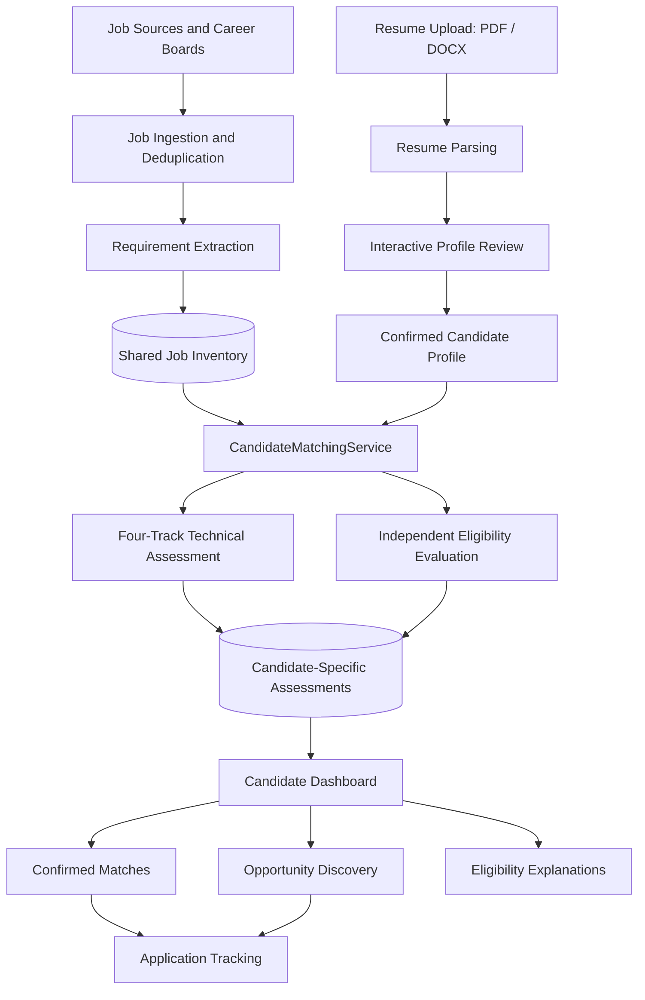
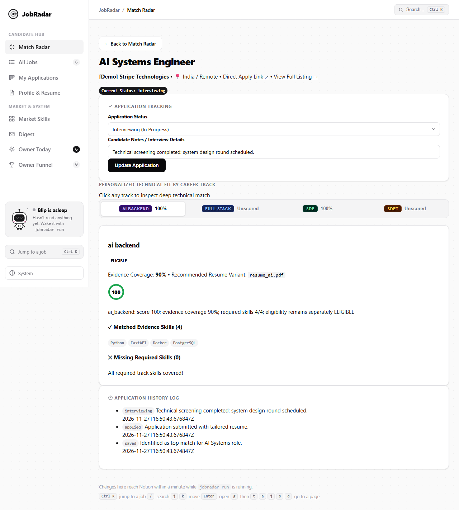

# JobRadar: AI-Assisted Multi-Candidate Career Intelligence Platform

[](LICENSE)
[](pyproject.toml)
[](pyproject.toml)
[](pyproject.toml)
[](submission/07_testing_and_validation_evidence.md)

JobRadar is a local-first career intelligence platform that helps technical job seekers discover hiring opportunities, evaluate technical alignment across specialized career tracks, independently assess eligibility constraints, and manage applications through a candidate-facing dashboard.

Originally created as an open-source personal job-search project by **Sameer ([@ThePlator](https://github.com/ThePlator))**, this repository represents an extensive architectural extension of that foundation into a multi-candidate platform with four-track technical matching, independent eligibility evaluation, resume onboarding, and candidate-specific application tracking.

**This is my primary engineering contribution for the Spektra Systems AI-Native Software Engineer - Trainee evaluation.** The original project's contributions are acknowledged, and the extensions implemented in this repository are documented separately below.

---

## Project at a Glance

| Area | Description |
|---|---|
| Project | JobRadar - Career Intelligence Platform |
| My role | Project Developer |
| Primary contribution | Multi-candidate architecture and J4 career intelligence engine |
| Language | Python 3.11+ |
| Backend | FastAPI, SQLModel, SQLite |
| Matching | Four-track deterministic technical assessment |
| Eligibility | Independent evidence-based eligibility evaluation |
| Resume processing | PDF/DOCX extraction and structured profile review |
| Interface | Responsive candidate dashboard |
| Repository | [Bharadwaj710/JobRadar](https://github.com/Bharadwaj710/JobRadar) |
| Original foundation | [ThePlator/JobRadar](https://github.com/ThePlator/JobRadar) |

### What I Built and Extended

Building on the original job ingestion and processing foundation, I developed substantial new capabilities:

- **Multi-Candidate Architecture:** Reworked the original single-profile approach into candidate-specific profiles, assessments, and application data, with HMAC-SHA256 session signing and candidate ownership checks.
- **Resume Onboarding and Review:** Implemented PDF/DOCX resume processing, structured profile extraction, and an interactive review workflow before profile confirmation.
- **Four-Track J4 Matching Engine:** Implemented deterministic technical assessments across AI Backend, Full Stack, SDE / Systems, and SDET / QA.
- **Independent Eligibility Evaluation:** Separated hard eligibility requirements from technical fit, with four states: `ELIGIBLE`, `LIKELY_ELIGIBLE`, `NEEDS_VERIFICATION`, and `NOT_ELIGIBLE`.
- **Opportunity Discovery:** Preserved relevant postings with missing eligibility metadata instead of automatically discarding them.
- **Candidate Application Tracking:** Added candidate-specific application stages, transition history, and audit records.
- **Responsive Candidate Dashboard:** Developed the candidate-facing interface with track filtering, match explanations, dark/light themes, and responsive navigation.
- **Isolated Demo Environment:** Implemented a deterministic demo seeder using synthetic candidate and job records, separated from the production database.

---

## Open-Source Origin and Contribution Transparency

JobRadar is an extended derivative project, not an entirely original implementation.

| Item | Details |
|---|---|
| Original project | [ThePlator/JobRadar](https://github.com/ThePlator/JobRadar) |
| Original author | Sameer ([@ThePlator](https://github.com/ThePlator)) |
| Original base commit | `fdd739b` |
| Original license | MIT |
| Original documentation | [Archived upstream README](docs/ORIGINAL_README.md) |
| License file | [LICENSE](LICENSE) |

### What the Original Foundation Provided

The upstream project provided the initial single-user job discovery and processing foundation, including:

- Python job ingestion pipeline and source adapters.
- Telegram, email, and job-board source integrations.
- URL normalization, link expansion, and posting deduplication.
- Initial HTML/text extraction and fallback LLM infrastructure.
- SQLite persistence and background task processing.
- Original CLI tooling and resume-related functionality.

### What I Re-Engineered and Extended

My primary engineering work focused on transforming that foundation into a candidate-facing, multi-candidate career intelligence platform.

The extensions include the candidate data model, resume onboarding and profile review, independent eligibility engine, four-track J4 matching, candidate-specific assessment persistence, application tracking, web interface, and isolated demo workflow.

The original license and copyright notice are preserved. The archived upstream documentation is available at [docs/ORIGINAL_README.md](docs/ORIGINAL_README.md).

---

## Codebase Tour: Where to Explore the Implementation

The following reading path helps technical reviewers inspect the most important engineering components without navigating the entire repository.

| Order | Source file | What to inspect |
|---|---|---|
| 1 | [`src/jobradar/services/matching_service.py`](src/jobradar/services/matching_service.py) | Candidate-specific matching orchestration and assessment persistence |
| 2 | [`src/jobradar/pipeline/technical_match.py`](src/jobradar/pipeline/technical_match.py) | Four-track deterministic technical scoring |
| 3 | [`src/jobradar/pipeline/eligibility.py`](src/jobradar/pipeline/eligibility.py) | Independent eligibility evaluation and evidence handling |
| 4 | [`src/jobradar/web/session.py`](src/jobradar/web/session.py) | HMAC-SHA256 session signing, validation, and CSRF-related protections |
| 5 | [`src/jobradar/resume/parser.py`](src/jobradar/resume/parser.py) | Resume profile extraction and structured profile drafts |
| 6 | [`src/jobradar/db/models.py`](src/jobradar/db/models.py) | Database entities and persistence models |
| 7 | [`tests/test_phase3_final_e2e_validation.py`](tests/test_phase3_final_e2e_validation.py) | Complete candidate journey and isolation testing |

### Repository Structure

```text
JobRadar/
│
├── README.md
├── LICENSE
├── pyproject.toml
├── config.example.yaml
├── profile.example.yaml
│
├── src/
│   └── jobradar/
│       ├── web/                 # Candidate-facing web application
│       ├── services/            # Candidate matching orchestration
│       ├── pipeline/            # Technical matching and eligibility
│       ├── resume/              # Resume extraction and parsing
│       └── db/                  # Database models and repositories
│
├── scripts/
│   └── prepare_demo_data.py     # Isolated synthetic demo seeder
│
├── tests/                       # Unit, integration and browser tests
│
├── submission/                  # Evaluation documentation and evidence
│   └── screenshots/             # Curated interface screenshots
│
└── docs/
    └── ORIGINAL_README.md        # Archived upstream documentation
```

---

## 1. Problem Statement

Early-career software engineering candidates face several challenges when navigating the job market:

- **Scattered Opportunities:** Job postings appear across company career pages, applicant tracking systems, Telegram channels, and hiring announcements.
- **Incomplete Metadata:** Job postings frequently omit graduation-year, degree, or experience requirements.
- **Conflated Matching and Eligibility:** A candidate can be technically suitable for a role but fail a mandatory eligibility condition.
- **Limited Explainability:** Generic match percentages rarely explain which skills are supported by evidence and which requirements remain missing.
- **Application Tracking:** Candidates need a consistent way to manage applications and track their progress.

JobRadar addresses these challenges by combining shared job discovery with candidate-specific technical assessments, independent eligibility evaluation, transparent explanations, and application tracking.

---

## 2. Four-Track J4 Technical Matching Engine

JobRadar evaluates opportunities across four specialized technical career tracks.

| Track | Focus Areas |
|---|---|
| **AI Backend** | Python, FastAPI, ML/AI integration, LLM APIs, SQL, Docker, and backend services |
| **Full Stack** | React, TypeScript, Node.js, Next.js, REST APIs, and frontend/backend integration |
| **SDE / Systems** | C++, Java, Go, operating systems, networking, algorithms, and distributed systems |
| **SDET / QA** | Pytest, Selenium, Playwright, CI/CD, test automation, and end-to-end testing |

A job can be assessed independently across multiple tracks. The resulting assessments provide track-specific technical scores and explanations.

### Technical Scoring Components

The J4 engine uses eight weighted components defined in [`src/jobradar/pipeline/technical_match.py`](src/jobradar/pipeline/technical_match.py).

| Component | Weight |
|---|---:|
| Role alignment | 25% |
| Required skills | 25% |
| Preferred skills | 5% |
| Project and internship relevance | 15% |
| Education and graduation fit | 10% |
| Experience and seniority fit | 10% |
| Location and work mode | 5% |
| Compensation | 5% |
| **Total** | **100%** |

The engine also uses a minimum evidence-coverage threshold of 0.70.

### Evidence-Based Matching

The matching engine evaluates approved candidate evidence from skills, projects, education, and experience.

A skill that is not supported by the candidate's approved profile evidence is not automatically treated as demonstrated.

Missing evidence remains unknown or missing rather than being converted into a fabricated qualification.

**Important:** A technical match score is an assessment of technical alignment, not a probability of getting an interview or being hired.

---

## 3. Independent Eligibility Evaluation

Technical suitability and employer eligibility are separate assessments.

A candidate might have strong technical alignment but fail a mandatory graduation-year requirement. Another candidate might satisfy all eligibility conditions but have limited technical alignment.

JobRadar keeps these decisions separate.

### Eligibility States

| State | Meaning |
|---|---|
| `ELIGIBLE` | Explicit hard requirements are satisfied using available evidence. |
| `LIKELY_ELIGIBLE` | Available posting context strongly supports eligibility without a contradictory constraint. |
| `NEEDS_VERIFICATION` | Important eligibility information is missing or uncertain. |
| `NOT_ELIGIBLE` | An explicit requirement conflicts with the candidate's confirmed profile. |

### Opportunity Discovery

Many real-world job postings omit graduation-year or other important eligibility information.

Instead of treating missing information as an automatic rejection, JobRadar can classify such opportunities as `NEEDS_VERIFICATION`.

These opportunities are surfaced in the candidate dashboard with explanations of the missing criteria, allowing candidates to verify them before applying.

This preserves potentially relevant opportunities without pretending that unknown requirements have been satisfied.

---

## 4. System Architecture

JobRadar separates shared job inventory from private candidate assessments and application records.



### End-to-End Workflow

1. **Job Discovery:** Job postings are collected through the configured ingestion sources.
2. **Shared Inventory:** Job records are normalized, deduplicated, and stored in the shared inventory.
3. **Candidate Onboarding:** A candidate uploads a resume and reviews the extracted profile information.
4. **Profile Confirmation:** The candidate confirms the profile before assessments are generated.
5. **Matching:** `CandidateMatchingService` evaluates jobs against the candidate's approved profile.
6. **Assessment Persistence:** Technical assessments and eligibility results are stored in candidate-specific records.
7. **Dashboard:** Candidates see confirmed matches, opportunities requiring verification, and eligibility explanations.
8. **Application Tracking:** Candidates manage their own application stages and history.

---

## 5. Transparent AI Usage

JobRadar distinguishes between runtime AI features and deterministic application logic.

### Runtime AI

The application uses LiteLLM for configured language-model providers in the job-description extraction fallback workflow.

- Deterministic rules and heuristics are used first for job requirement extraction.
- LLM fallback supports complex or unstructured job descriptions.
- Structured outputs are validated using Pydantic schemas.
- Provider configuration is maintained through the application configuration.

### Deterministic Application Logic

The following components are implemented as Python logic:

- Four-track J4 technical scoring.
- Eligibility state evaluation.
- Candidate ownership and session validation.
- Candidate-specific assessment orchestration.
- Database persistence and application tracking.

Resume processing supports deterministic, LLM-assisted, and hybrid extraction modes, with extraction metadata identifying the parser mode.

### What JobRadar Does Not Claim

The current implementation does not depend on:

- Vector databases such as Pinecone, Chroma, or Qdrant.
- A vector-embedding-based RAG pipeline.
- Autonomous application submission.

Candidates remain responsible for reviewing opportunities and submitting applications.

### AI-Assisted Development

Claude Code and Antigravity were used as software engineering tools under my direction to assist with codebase exploration, implementation, refactoring, testing, debugging, and documentation.

Implementation decisions, integration, and validation were subject to human review and engineering checks.

---

## 6. Technology Stack

| Category | Technologies |
|---|---|
| Language | Python 3.11+ |
| Web framework | FastAPI, Starlette, Uvicorn |
| Data models and persistence | SQLModel, SQLAlchemy, SQLite |
| Validation | Pydantic |
| Templates | Jinja2 |
| Job extraction | LiteLLM, configured LLM providers |
| Document processing | pypdf and supported DOCX processing |
| Frontend | HTML5, CSS, JavaScript |
| Testing | Pytest, Playwright |
| Code quality | Ruff, Mypy |
| Package management | uv |

The web and browser-testing dependencies are configured as optional dependency groups in [`pyproject.toml`](pyproject.toml).

---

## 7. Visual Demonstration

The following screenshots demonstrate the candidate-facing application using synthetic demo records.

### Resume Onboarding

Candidates can upload resumes and begin the profile extraction workflow.


### Interactive Profile Review

Candidates can review and edit extracted profile information before confirmation.


### Candidate Dashboard

The dashboard displays confirmed matches and opportunities requiring eligibility verification.


### Track-Specific Filtering

Candidates can explore opportunities using specialized career-track filters.


### Eligibility Transparency

Ineligible opportunities include explanations of the conflicting eligibility requirements.


### Job Fit Breakdown

The job detail view provides technical fit explanations and skill-gap information.



### Application Tracking

Candidates can manage their application pipeline through the Kanban interface.


All displayed screenshots use synthetic demonstration records.

See the complete [Screenshot Index](submission/SCREENSHOT_INDEX.md).

---

## 8. Local Setup and Demo Execution

### Prerequisites

- Python 3.11 or later.
- Git.
- [uv package manager](https://github.com/astral-sh/uv).

### Step 1: Clone the repository

```powershell
git clone https://github.com/Bharadwaj710/JobRadar.git
Set-Location JobRadar
```

### Step 2: Install dependencies

```powershell
uv sync --extra web
```

### Step 3: Prepare the isolated demo database

The demo workflow creates synthetic candidate and job records in a separate database.

```powershell
uv run python scripts/prepare_demo_data.py --reset
```

### Step 4: Select the demo database

```powershell
$env:JOBRADAR_DB_PATH = "data/demo/jobradar_demo.db"
```

### Step 5: Launch the application

```powershell
uv run jobradar web
```

Open the dashboard:

```text
http://127.0.0.1:8080/candidate/dashboard
```

### Verify Demo Integrity

```powershell
uv run python scripts/prepare_demo_data.py --verify
```

**Important:** Keep the demo database path configured when using the demo environment. The default database path is separate from the isolated demo database.

### Optional: Browser Testing Dependencies

To run the Playwright browser tests:

```powershell
uv sync --extra web --extra browser
uv run playwright install chromium
```

### Optional: Original Ingestion Workflow

The original ingestion and background processing workflow can be launched separately:

```powershell
uv run jobradar run
```

Full source ingestion requires network access and any credentials required by the configured integrations.

---

## 9. Testing and Engineering Quality

The repository includes unit, integration, pipeline, and browser-level testing.

The following results are documented in the formal validation evidence. They represent recorded validation runs, not tests newly executed while writing this README.

| Validation | Recorded result |
|---|---|
| Full Pytest unit and integration suite | **994 passed, 2 skipped, 0 failed** |
| Dedicated Phase 3 E2E suite | **8 passed, 0 failed** |
| Playwright browser E2E suite | **6 passed, 0 failed** |
| Ruff formatting | **182 files formatted** |
| Ruff linting | **0 reported errors or warnings across 182 files** |
| Mypy strict type checking | **0 issues across 102 source files** |

The two skipped tests in the full suite relate to the unavailable LaTeX engine in the recorded Windows environment.

The specialized Phase 3 and Playwright suites are separately reported and are not added to the main Pytest count.

Full execution logs and supporting evidence are available in [submission/07_testing_and_validation_evidence.md](submission/07_testing_and_validation_evidence.md).

---

## 10. Known Limitations

The following boundaries are documented in the current implementation:

1. **LaTeX Compiler:** Compiled PDF resume generation requires a local LaTeX installation such as MiKTeX on Windows. HTML and text previews are available when the compiler is absent.
2. **TypeSafe Jev Integration:** Live provider integration is deferred pending API access.
3. **Profile Confirmation:** Automated Match Radar assessments require a confirmed candidate profile.
4. **Notion Integration:** Notion mirroring is disabled by default in the candidate-facing configuration.
5. **Legacy Database Fields:** Some original single-user schema fields remain for backward compatibility. Candidate workflows use candidate-specific records.

For additional details, see [submission/08_known_limitations.md](submission/08_known_limitations.md).

---

## 11. Documentation and Further Exploration

| Document | Purpose |
|---|---|
| [Submission Dossier](submission/README.md) | Index and overview of the engineering submission |
| [Project Overview](submission/01_project_overview.md) | Problem statement, provenance, and contribution scope |
| [System Architecture](submission/02_system_architecture.md) | Multi-candidate design and architecture |
| [End-to-End Pipeline](submission/03_end_to_end_pipeline.md) | Job discovery, extraction, and processing workflow |
| [AI Engineering Methodology](submission/04_ai_agent_engineering_methodology.md) | AI-assisted engineering approach |
| [Selected Agent Conversations](submission/05_selected_agent_conversations.md) | Engineering problem-solving case studies |
| [Code Review and Quality Gates](submission/06_code_review_and_quality_gates.md) | Code quality and static analysis |
| [Testing and Validation Evidence](submission/07_testing_and_validation_evidence.md) | Recorded test results and execution logs |
| [Known Limitations](submission/08_known_limitations.md) | Technical boundaries and deferred integrations |
| [Demo Walkthrough](submission/09_demo_walkthrough.md) | Step-by-step demo instructions |
| [Screenshot Index](submission/SCREENSHOT_INDEX.md) | Curated interface screenshots |
| [Original Upstream README](docs/ORIGINAL_README.md) | Preserved original project documentation |

---

## 12. License and Attribution

This repository retains the original upstream MIT license and copyright notice.

See [LICENSE](LICENSE) for the full license terms.

Original project: [Sameer (@ThePlator) - JobRadar](https://github.com/ThePlator/JobRadar).

Extended project repository: [Bharadwaj710/JobRadar](https://github.com/Bharadwaj710/JobRadar).

